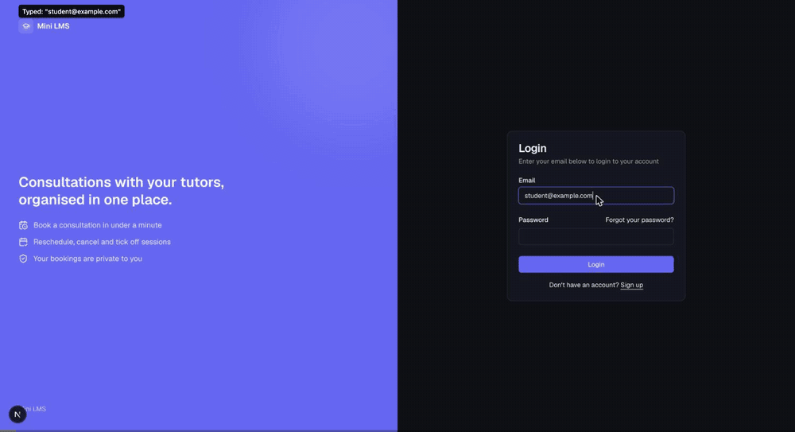
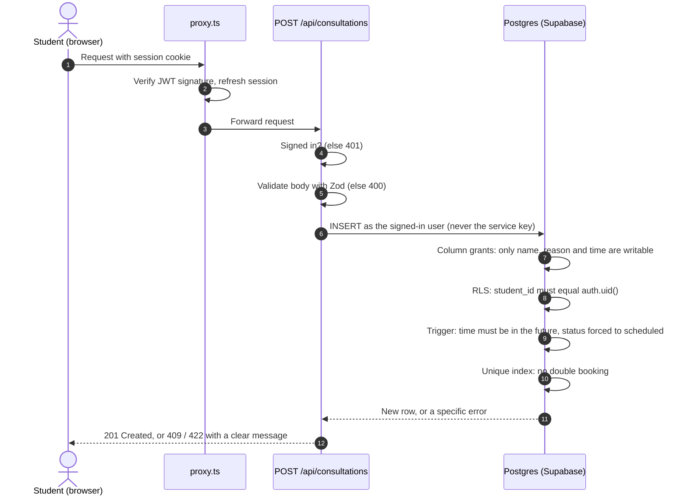

# Mini LMS: Student Consultations

[](https://github.com/anushagarg-10/mini-lms-consultations/actions/workflows/ci.yml)

A small learning management system where students book and manage consultations, and admins can see every consultation in the system.

**Student:** log in, book a consultation, mark it complete, cancel another.



**Admin:** see every consultation across all students, filter by status (read-only).


**Built with:** Next.js 16 (App Router), TypeScript, Supabase (Postgres, Auth, `supabase-js`, `@supabase/ssr`), shadcn/ui, Tailwind and Zod. Based on the official `with-supabase` starter.

## Features

- **Accounts:** sign up, log in, log out and reset your password.
- **Student dashboard:** your consultations, split into Upcoming, Past and Cancelled.
- **Book:** first name, last name, reason, and a date and time.
- **Manage:** mark a consultation complete or incomplete, reschedule it, or cancel it.
- **Admin view:** `/admin` shows every consultation across all students. It is read-only.

## Getting started

You need Node.js 20+ and Docker running (Docker Desktop or OrbStack).

```bash
npm install
npx supabase start          # starts Supabase locally, runs migrations and seed data
npx supabase status         # shows the API URL and Publishable key
cp .env.example .env.local  # paste those two values in
npm run dev                 # open http://localhost:3000
```

If `supabase start` is interrupted and the app can't find its tables, run `npx supabase db reset`.

### Test accounts

| Email                  | Password              | Role    |
| ---------------------- | --------------------- | ------- |
| `admin@example.com`    | `Demo-VmbwANdcZj-Lms` | Admin   |
| `student@example.com`  | `Demo-VmbwANdcZj-Lms` | Student |
| `student2@example.com` | `Demo-VmbwANdcZj-Lms` | Student |

Anyone who signs up becomes a student. To make someone an admin, run this in Supabase Studio (http://127.0.0.1:54323):

```sql
update public.profiles set role = 'admin' where email = 'someone@example.com';
```

### Useful commands

| Command                                              | What it does                                              |
| ---------------------------------------------------- | --------------------------------------------------------- |
| `npm run test:db`                                    | Runs 35 database security tests (no Docker needed)        |
| `npx supabase db reset`                              | Rebuilds the local database from migrations and seed data |
| `npm run typecheck`, `npm run lint`, `npm run build` | Code checks                                               |
| `npm run format` / `npm run format:check`            | Format with Prettier / check formatting                   |

GitHub Actions runs lint, the format check, the database tests, the build, the typecheck and a Docker image build on every push and pull request (`.github/workflows/ci.yml`).

### Running with Docker

The `Dockerfile` builds a small production image (Next.js standalone output, non-root user, health check). Point it at a hosted Supabase project:

```bash
docker build \
  --build-arg NEXT_PUBLIC_SUPABASE_URL=https://<project>.supabase.co \
  --build-arg NEXT_PUBLIC_SUPABASE_PUBLISHABLE_KEY=<publishable-key> \
  -t mini-lms .
docker run -p 3000:3000 mini-lms
```

The two values are build args because Next.js puts `NEXT_PUBLIC_` variables into the browser bundle at build time. Both are public by design, and the app needs no secret keys. Apply the schema to the hosted project first with `npx supabase link --project-ref <ref>` and `npx supabase db push`.

### Logs

Server logs are JSON, one line per event, for example:

```json
{
  "level": "info",
  "time": "2026-11-21T06:40:25.432Z",
  "msg": "request",
  "service": "mini-lms",
  "requestId": "19bf6cfe-...",
  "method": "POST",
  "path": "/api/consultations",
  "status": 201,
  "durationMs": 42
}
```

Every API response carries the same `x-request-id`, so a reported error can be matched to its log line. Logs contain ids only, never names, emails or request bodies. Set `LOG_LEVEL` (`debug`, `info`, `warn`, `error`) to change verbosity.

## How it works

> For the full design write-up (why Postgres, the data model column by column, folder structure, layers, error handling, logging and scalability) see **[docs/ARCHITECTURE.md](docs/ARCHITECTURE.md)**.

- **Pages** (`app/(app)/dashboard`, `app/(app)/admin`) load their data on the server.
- **Changes** (book, complete, reschedule, cancel) go through REST API routes, not Server Actions:

  | Method | Route                      | Purpose                                            |
  | ------ | -------------------------- | -------------------------------------------------- |
  | GET    | `/api/consultations`       | Your consultations                                 |
  | POST   | `/api/consultations`       | Book a consultation                                |
  | PATCH  | `/api/consultations/:id`   | Reschedule, mark complete or incomplete, or cancel |
  | GET    | `/api/admin/consultations` | All consultations, paginated (admins only)         |

- **Shared logic** lives in `lib/consultations/`: one set of Zod schemas for validation and one service for database queries, used by both pages and API routes.
- **Database** setup is in `supabase/migrations/`: a `profiles` table (one per user, holds the role) and a `consultations` table.

### What happens when a student books

Every request passes through several independent checks. If one layer had a bug, the next would still stop bad data.



Admins go through the same path. Their extra access comes only from a database rule (`is_admin()`) that lets them **read** every row. No rule lets them write, so the admin view is read-only at the database level.

## Key decisions

1. **Roles are stored in the database, not in the user's profile metadata.** Supabase lets users edit their own metadata, so a role kept there could be changed by the user. Instead, every new user gets a `profiles` row with the role `student`, and users can't edit that table.
2. **The database enforces the rules, not just the API.** Supabase's public key means anyone signed in could call the database directly, so security can't rely on the Next.js routes alone. Row Level Security (RLS) makes sure students only see and change their own consultations, and admins can read everything but change nothing. Database triggers block invalid changes, such as booking in the past or editing a cancelled consultation.
3. **Cancelling keeps the record.** A cancelled consultation is marked as cancelled rather than deleted, so admins keep the history and students have nothing they can permanently delete.
4. **One change per request.** Each PATCH does exactly one thing (reschedule, complete or cancel), which keeps validation and error messages simple.
5. **Requests run as the signed-in user.** The app never uses Supabase's all-access service key, so a bug in an API route still can't expose another student's data.

## Assumptions

- Bookings are confirmed immediately. There is no approval step, because the brief has no approver role and asks for a read-only admin view. Adding one later would mean a `pending` status, a database rule letting admins change only that status, and a notification to the student.
- First and last name are entered per booking, so a parent could book for a student.
- "Complete" is a checkbox the student controls, and can be ticked at any time.
- A completed consultation must be marked incomplete before it can be rescheduled or cancelled.
- Cancelling is final. To change your mind, book again.
- Bookings must be in the future and within a year. Tutors, availability and business hours aren't modelled.
- A student can't have two active bookings at the same time.
- Times are stored in UTC and shown in the viewer's own timezone.

## With more time

- Rate limiting on sign-in and booking.
- API and end-to-end browser tests, running in CI.
- Search on the admin view and pagination on the student dashboard.
- Tutors with availability, so double bookings are prevented per tutor.
- An audit log of who changed what.
