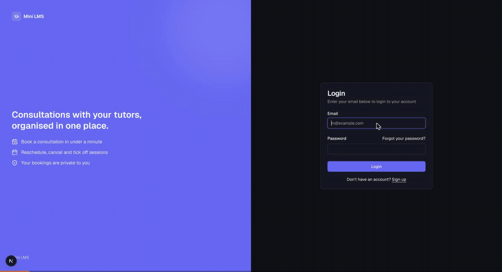
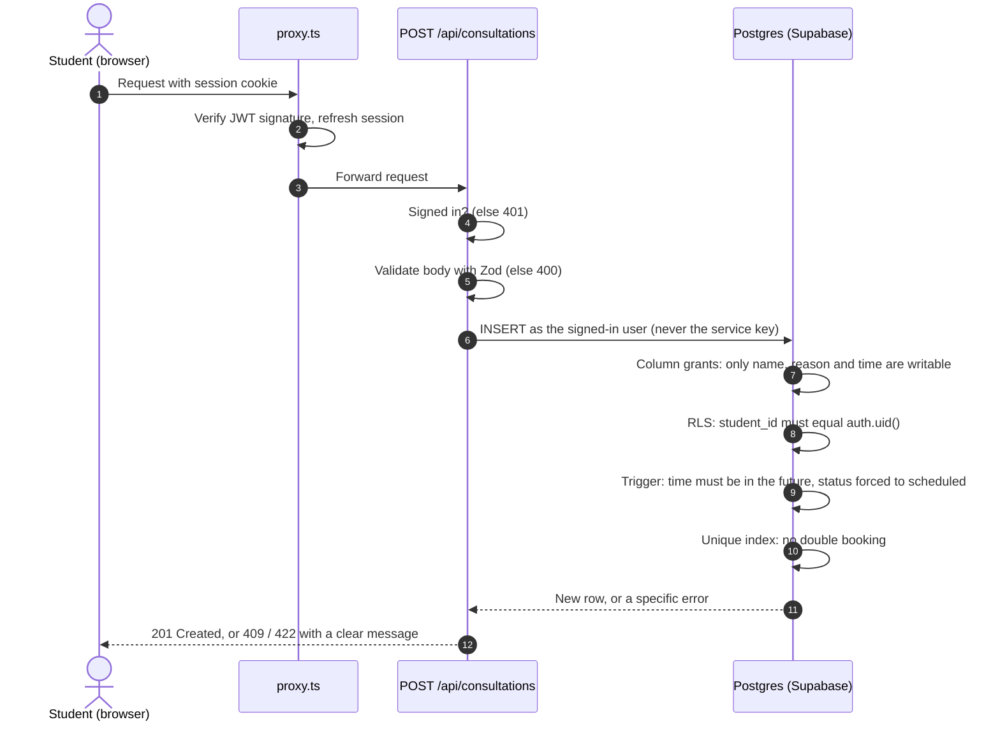

# Mini LMS: Student Consultations

[](https://github.com/anushagarg-10/mini-lms-consultations/actions/workflows/ci.yml)

A small learning management system where students book and manage consultations, and admins can see every consultation in the system.

**Live demo:** https://mini-lms-consultations.netlify.app (hosted on Netlify, with a hosted Supabase project). Sign in with the test accounts below.

**Student:** log in, book a consultation, mark it complete, cancel another.


**Admin:** log in to an overview with reminders, every consultation across all students, and a detail page for each one (read-only).



**Built with:** Next.js 16 (App Router), TypeScript, Supabase (Postgres, Auth, `supabase-js`, `@supabase/ssr`), shadcn/ui, Tailwind and Zod. Based on the official `with-supabase` starter.

## Features

- **Accounts:** sign up, log in, log out and reset your password.
- **Student dashboard:** your consultations, split into Upcoming, Past and Cancelled.
- **Book:** first name, last name, reason, and a date and time.
- **Manage:** mark a consultation complete or incomplete, reschedule it, or cancel it.
- **Admin view:** `/admin` shows an overview (consultations in the next 24 hours and 7 days, completed, cancelled, and the next few coming up), then every consultation across all students, filterable by status. Reminder labels such as "Tomorrow" or "In 3 days" flag what's coming up.
- **Consultation details (admin):** clicking any consultation opens `/admin/consultations/:id` with the full request, the student's account, a timeline (booked, changed, completed, cancelled) and the student's other consultations. Everything for admins is read-only, and admins don't book consultations.

## Getting started

You need Node.js 20+ and Docker running (Docker Desktop or OrbStack).

```bash
npm install
npx supabase start          # starts Supabase locally, runs migrations and seed data
npx supabase status -o env  # prints API_URL and PUBLISHABLE_KEY
cp .env.example .env.local  # paste those two values in
npm run dev                 # open http://localhost:3000
```

If `supabase start` is interrupted and the app can't find its tables, run `npx supabase db reset`.

### Test accounts

| Email                  | Password              | Role    |
| ---------------------- | --------------------- | ------- |
| `admin@example.com`    | `Demo-VmbwANdcZj-Lms` | Admin   |
| `student@example.com`  | `Demo-VmbwANdcZj-Lms` | Student |
| `student2@example.com` | `Demo-VmbwANdcZj-Lms` | Student |

Anyone who signs up becomes a student. To make someone an admin, run this in Supabase Studio (http://127.0.0.1:54323):

```sql
update public.profiles set role = 'admin' where email = 'someone@example.com';
```

### Useful commands

| Command                                              | What it does                                                                |
| ---------------------------------------------------- | --------------------------------------------------------------------------- |
| `npm run test:db`                                    | Runs 38 database security tests (no Docker needed)                          |
| `npm run test:api`                                   | Runs 34 API tests over real HTTP (needs the app and local Supabase running) |
| `npx supabase db reset`                              | Rebuilds the local database from migrations and seed data                   |
| `npm run typecheck`, `npm run lint`, `npm run build` | Code checks                                                                 |
| `npm run format` / `npm run format:check`            | Format with Prettier / check formatting                                     |

GitHub Actions runs lint, the format check, the database tests, the build, the typecheck, a Docker image build, and the API tests against a real Supabase started in CI, on every push and pull request (`.github/workflows/ci.yml`).

### Running with Docker

The `Dockerfile` builds a small production image (Next.js standalone output, non-root user, health check). Point it at a hosted Supabase project:

```bash
docker build \
  --build-arg NEXT_PUBLIC_SUPABASE_URL=https://<project>.supabase.co \
  --build-arg NEXT_PUBLIC_SUPABASE_PUBLISHABLE_KEY=<publishable-key> \
  -t mini-lms .
docker run -p 3000:3000 mini-lms
```

The two values are build args because Next.js puts `NEXT_PUBLIC_` variables into the browser bundle at build time. Both are public by design, and the app needs no secret keys. Apply the schema to the hosted project first with `npx supabase link --project-ref <ref>` and `npx supabase db push`.

### Logs

Server logs are JSON, one line per event, for example:

```json
{
  "level": "info",
  "time": "2026-11-21T06:40:25.432Z",
  "msg": "request",
  "service": "mini-lms",
  "requestId": "19bf6cfe-...",
  "method": "POST",
  "path": "/api/consultations",
  "status": 201,
  "durationMs": 42
}
```

Every API response carries the same `x-request-id`, so a reported error can be matched to its log line. Logs contain ids only, never names, emails or request bodies. Set `LOG_LEVEL` (`debug`, `info`, `warn`, `error`) to change verbosity.

## How it works

> For the full design write-up (why Postgres, the data model column by column, folder structure, layers, error handling, logging and scalability) see **[docs/ARCHITECTURE.md](docs/ARCHITECTURE.md)**.

- **Pages** (`app/(app)/dashboard`, `app/(app)/admin`) load their data on the server.
- **Changes** (book, complete, reschedule, cancel) go through REST API routes, not Server Actions:

  | Method | Route                          | Purpose                                                                                 |
  | ------ | ------------------------------ | --------------------------------------------------------------------------------------- |
  | GET    | `/api/consultations`           | Your consultations                                                                      |
  | POST   | `/api/consultations`           | Book a consultation                                                                     |
  | PATCH  | `/api/consultations/:id`       | Reschedule, mark complete or incomplete, or cancel                                      |
  | GET    | `/api/admin/consultations`     | All consultations, paginated, `?status=scheduled\|completed\|cancelled` (admins only)   |
  | GET    | `/api/admin/consultations/:id` | One consultation with the student's account and their other consultations (admins only) |

- **Shared logic** lives in `lib/consultations/`: one set of Zod schemas for validation and one service for database queries, used by both pages and API routes.
- **Database** setup is in `supabase/migrations/`: a `profiles` table (one per user, holds the role) and a `consultations` table.

### What happens when a student books

Every request passes through several independent checks. If one layer had a bug, the next would still stop bad data.



Admins can't take this path at all: the API answers 403, and the database's write rules require the `student` role (`is_student()`). Their only extra access is a rule (`is_admin()`) that lets them **read** every row, so the admin view is read-only at the database level.

## Decisions and why

Every choice below is something I decided on purpose. For each one: what I did, why, and what it costs. The [architecture doc](docs/ARCHITECTURE.md) goes deeper on the data model and scalability.

### Roles and security

| What I did                                                                                                                                                                                                                                                                           | Why                                                                                                                                                                                   | Trade-off                                                                                                                     |
| ------------------------------------------------------------------------------------------------------------------------------------------------------------------------------------------------------------------------------------------------------------------------------------ | ------------------------------------------------------------------------------------------------------------------------------------------------------------------------------------- | ----------------------------------------------------------------------------------------------------------------------------- |
| **Stored the role in a `profiles` table**, created by a trigger for every new user (always `student`). Admins are promoted by an operator in SQL.                                                                                                                                    | Supabase lets users edit their own `user_metadata`, so a role stored there could be self-assigned. Users have no write access to `profiles` at all, so nobody can promote themselves. | Promoting an admin needs database access rather than a button. For this brief that's a feature: no UI can grant admin rights. |
| **Enforced every rule in the database**: Row Level Security, column-level grants and triggers, not just checks in the API.                                                                                                                                                           | Supabase's publishable key is public, so anyone signed in can call the database directly and skip my API routes. The database is the only layer every request has to pass through.    | The rules live in SQL, which is less familiar than TypeScript. I kept the API checks too, purely for clear error messages.    |
| **Checked roles at three levels**: pages (redirects and 404), API routes (403) and database policies.                                                                                                                                                                                | If any one layer has a bug, the others still hold. I tested this: removing the API's role check did not let an admin book, because the database refused.                              | The same rule is written in more than one place.                                                                              |
| **Gave each role exactly one area.** Students only see "My consultations" and are the only role that can write. Admins only see "All consultations" and can only read.                                                                                                               | The brief describes a student-facing dashboard and an admin view, and nothing about admins booking. One clear job per role is easier to reason about and to secure.                   | An admin can't book a consultation for themselves. Nothing in the brief needs that.                                           |
| **Never used the service-role key.** Every query runs as the signed-in user.                                                                                                                                                                                                         | Even a bug in a route can't read or change another student's data, because the database applies that user's permissions.                                                              | A few things (like seeding) happen in SQL instead of in app code.                                                             |
| **Hid other people's data behind 404, not 403**, and gated `/admin` in a layout so non-admins get a real 404.                                                                                                                                                                        | A 403 confirms that a consultation or page exists. A 404 reveals nothing.                                                                                                             | Slightly less specific errors for anyone probing.                                                                             |
| **Smaller hardening**: verified sessions with `getClaims()` (checks the JWT signature), fixed an open redirect in the starter's `/auth/confirm`, required JSON request bodies (a simple CSRF guard alongside `SameSite` cookies), added security headers and removed `X-Powered-By`. | Each closes a small, real gap at very low cost.                                                                                                                                       | None worth noting.                                                                                                            |

### Data model

| What I did                                                                                                                                                   | Why                                                                                                                                                                               | Trade-off                                                                                 |
| ------------------------------------------------------------------------------------------------------------------------------------------------------------ | --------------------------------------------------------------------------------------------------------------------------------------------------------------------------------- | ----------------------------------------------------------------------------------------- |
| **Used PostgreSQL constraints** for the important rules: no double booking (a partial unique index), no booking in the past, cancelled is final (a trigger). | Rules in the database hold for every client and can't be forgotten in one code path. A document database would push all of this into application code.                            | Changing a rule means writing a migration.                                                |
| **Cancelled by changing the status, not deleting.**                                                                                                          | Admins keep the full history, and students have no destructive action available. A cancelled slot can still be booked again because the unique index only covers active bookings. | The table keeps growing. Fine at this scale, and the indexes keep queries fast.           |
| **Stored "completed" as a timestamp (`completed_at`)** instead of a true/false flag.                                                                         | It records _when_ it was completed for free, and stays independent of scheduled/cancelled.                                                                                        | Slightly more logic to show a simple checkbox.                                            |
| **Kept first and last name on each booking**, not taken from the account.                                                                                    | The brief lists them as booking fields, and it lets someone (say, a parent) book on a student's behalf.                                                                           | The name can differ from the account email, so the admin view shows both.                 |
| **Stored times in UTC (`timestamptz`)** and displayed them in the viewer's own timezone.                                                                     | Avoids daylight-saving and timezone bugs. A booking at 3pm in Melbourne is still 3pm for that student.                                                                            | The server can't render local times, so dates appear after the page loads in the browser. |
| **Added a new migration when the rules changed**, instead of editing the old ones.                                                                           | Migrations that have already run must never change, or databases drift apart.                                                                                                     | One more file in `supabase/migrations/`.                                                  |

### API and app structure

| What I did                                                                                                                  | Why                                                                                                                                            | Trade-off                                                                                                                |
| --------------------------------------------------------------------------------------------------------------------------- | ---------------------------------------------------------------------------------------------------------------------------------------------- | ------------------------------------------------------------------------------------------------------------------------ |
| **Put every change behind REST API routes**, with no Server Actions.                                                        | The brief asked for APIs. Routes also give a contract I can test over real HTTP and reuse from any client.                                     | A little more code than Server Actions (a fetch wrapper on the client).                                                  |
| **Let pages read on the server** through the same service functions the API uses.                                           | Pages arrive with their data (no loading spinner, no extra HTTP hop), and there's still only one implementation of each query.                 | Two entry points (page and API) call the same function, which I keep in one service file to avoid drift.                 |
| **Allowed exactly one change per PATCH request** (reschedule, complete or cancel).                                          | Each request maps to one user intent, gets one clear error, and keeps the database's state rules simple to check.                              | Doing two things takes two requests.                                                                                     |
| **Shared Zod schemas** between the API (the real validation) and the forms (instant feedback), and rejected unknown fields. | Validation and TypeScript types come from one source and can't drift apart. Rejecting unknown fields means nobody can sneak in a `student_id`. | None worth noting.                                                                                                       |
| **Used one error type and one JSON error shape** for every route (`{ error: { code, message } }`).                          | Clients handle errors one way, and unexpected errors never leak internal details.                                                              | None worth noting.                                                                                                       |
| **Refreshed the page from the server after each change** (`router.refresh()`), rather than keeping a client-side cache.     | Nothing to keep in sync, so the UI can never show stale data after a change.                                                                   | Each change waits for a round trip. On the live site that's about 1.4 seconds; optimistic updates would make it instant. |

### User interface

| What I did                                                                                                                                                                                         | Why                                                                                                           | Trade-off                                                           |
| -------------------------------------------------------------------------------------------------------------------------------------------------------------------------------------------------- | ------------------------------------------------------------------------------------------------------------- | ------------------------------------------------------------------- |
| **Used shadcn/ui**, as the brief suggested.                                                                                                                                                        | Accessible components I can adjust in my own repo, so time went into functionality, not CSS.                  | None worth noting.                                                  |
| **Built a calendar plus a 30-minute time-slot picker** instead of the browser's date input, with past days and times disabled and bookings limited to the next year.                               | It's clearer for students and prevents obviously invalid choices before the server has to reject them.        | No business hours or tutor availability yet (see "With more time"). |
| **Made the admin view read-only with an overview**: counts for the next 24 hours and 7 days, reminders such as "In 3 days", and a detail page per consultation. Filters match the coloured badges. | An admin's real job is oversight, so the useful view is "what's coming up" and "what was this request about". | More than the brief's minimum "list of all consultations".          |

### Quality, testing and operations

| What I did                                                                                                                                  | Why                                                                                                                                                                                                           | Trade-off                                                                                   |
| ------------------------------------------------------------------------------------------------------------------------------------------- | ------------------------------------------------------------------------------------------------------------------------------------------------------------------------------------------------------------- | ------------------------------------------------------------------------------------------- |
| **Wrote 38 database tests on PGlite** (Postgres running in-process, no Docker needed).                                                      | Most of the security lives in SQL, so that's what needs the most testing, and it has to be quick to run anywhere.                                                                                             | PGlite is a stand-in for Supabase's auth schema, so the API tests cover the real stack too. |
| **Wrote 34 API tests over real HTTP** with real sessions. Each run signs up its own students.                                               | They test the app the way a browser uses it, including every status code, and never depend on or disturb seed data.                                                                                           | They need the app and Supabase running, which CI handles.                                   |
| **Ran everything in CI** on each push: lint, Prettier, both test suites, the build, the typecheck and a Docker build.                       | Every change is proven, and the badge shows it to anyone reading the repo.                                                                                                                                    | CI takes a few minutes.                                                                     |
| **Logged structured JSON** with a request ID that's also returned in the `x-request-id` header, and logged IDs only, never names or emails. | A user's error can be matched to its exact log line, and logs hold no personal data.                                                                                                                          | None worth noting.                                                                          |
| **Added error screens** with a reference code and a retry, and made the session check survive Supabase being unreachable.                   | One failing service shouldn't crash every page or quietly sign users out. I tested it by stopping the database.                                                                                               | None worth noting.                                                                          |
| **Deployed on Netlify with a hosted Supabase project in US East (Ohio)**, and added a Dockerfile.                                           | Reviewers can try it without installing anything. The free Netlify plan runs servers in Ohio, so I put the database next to them; that cut server time per change from about 1 second (Seoul) to about 90 ms. | Viewers in Australia still feel a short trip to the US.                                     |
| **Committed in small, explained steps.**                                                                                                    | The history shows how the project was built, which helps reviewing.                                                                                                                                           | None worth noting.                                                                          |

## What testing taught me

I tested the app as a student, an admin and a first-time reviewer cloning the repo. These are the problems that turned up and what I changed:

- **A page showed "not found" but returned HTTP 200.** A loading skeleton made the page start streaming before the role check ran. I moved role checks into layouts, which run first, so non-admins get a real 404 and admins get a real redirect.
- **The live site was slow** (about 5 seconds per change). The logs showed the server in Ohio talking to a database in Seoul, so I moved the database next to the server.
- **The setup steps didn't match the current Supabase CLI.** I found it by cloning the public repo fresh and following the README word for word, and fixed the instructions.
- **The admin's "Scheduled" filter also showed completed consultations.** I changed the filters to match the badges a user actually sees.

## Assumptions

- Bookings are confirmed immediately. There is no approval step, because the brief has no approver role and asks for a read-only admin view. Adding one later would mean a `pending` status, a database rule letting admins change only that status, and a notification to the student.
- First and last name are entered per booking, so a parent could book for a student.
- "Complete" is a checkbox the student controls, and can be ticked at any time.
- A completed consultation must be marked incomplete before it can be rescheduled or cancelled.
- Cancelling is final. To change your mind, book again.
- Bookings must be in the future and within a year. Tutors, availability and business hours aren't modelled.
- A student can't have two active bookings at the same time.
- Times are stored in UTC and shown in the viewer's own timezone.

## With more time

- Rate limiting on sign-in and booking.
- End-to-end browser tests (e.g. Playwright) for the main flows.
- Optimistic UI updates, so changes appear instantly instead of after a round trip.
- Search on the admin view and pagination on the student dashboard (it currently shows up to 500 consultations).
- A tutor role with availability: each consultation gets a tutor and a duration, students book from the tutor's free slots, and a Postgres exclusion constraint makes overlapping bookings for the same tutor impossible. Each tutor sees the consultations booked with them, and can accept or decline for reasons other than scheduling (illness, subject fit), since clashes are already prevented by the database.
- A meeting mode on each booking (online or in person), with a meeting link or a room. It needs the tutor role to be meaningful, and the brief fixes the booking fields, so it was left out.
- An audit log of who changed what.
- A custom email provider, so password-reset emails reach everyone on the live site (Supabase's free email service only sends to the project team).
