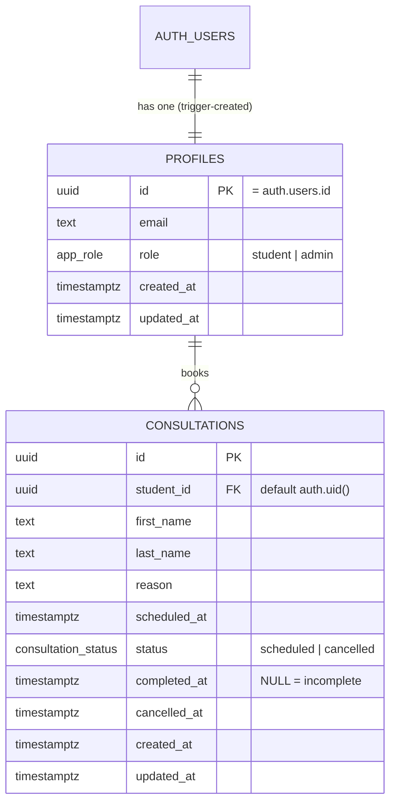

# Architecture and design decisions

This document explains how the app is put together and why. The [README](../README.md) covers setup and a short summary.

## 1. Technology choices

The brief fixed the core stack (Next.js 15/16 with the App Router, TypeScript, Supabase and Postgres). The reasons below are why that stack also suits this problem, and how each piece is used.

| Choice                              | Why it fits                                                                                                                                                                                                                                                                              |
| ----------------------------------- | ---------------------------------------------------------------------------------------------------------------------------------------------------------------------------------------------------------------------------------------------------------------------------------------- |
| **Next.js (App Router)**            | One codebase for the UI and the REST API. Server Components read data on the server, so pages arrive with data and no loading spinner, and less JavaScript ships to the browser. Route Handlers (`app/api/**/route.ts`) give a plain REST API, as the brief prefers over Server Actions. |
| **TypeScript**                      | Types flow from the database (`lib/supabase/database.types.ts`, generated from the schema) through the service layer to the UI, so a schema change shows up as a compile error, not a runtime bug.                                                                                       |
| **PostgreSQL (via Supabase)**       | See section 2.                                                                                                                                                                                                                                                                           |
| **Supabase Auth + `@supabase/ssr`** | Cookie-based sessions that work in Server Components, Route Handlers and the proxy alike. The JWT is verified with `getClaims()` (signature check), not trusted blindly.                                                                                                                 |
| **Zod**                             | One schema per request shape, used for validation in the API and for instant feedback in forms. TypeScript types are inferred from it, so validation and types can't drift apart.                                                                                                        |
| **shadcn/ui + Tailwind**            | Accessible Radix components copied into the repo (`components/ui`), so they can be adjusted without fighting a library. The brief asked to save time on styling.                                                                                                                         |

## 2. Why PostgreSQL rather than another database

The data is small but strongly **relational and rule-heavy**: users have roles, consultations belong to users, and a consultation moves through states with rules (no booking in the past, cancelled is final, no double booking). A relational database with constraints is the natural fit.

| Need                                               | PostgreSQL                                                   | A document store (e.g. MongoDB, Firestore)                                               |
| -------------------------------------------------- | ------------------------------------------------------------ | ---------------------------------------------------------------------------------------- |
| "A student can't double-book a time"               | One partial unique index                                     | Needs a transaction or a lock written in application code                                |
| "Cancelled is final", "only future times"          | `CHECK` constraints and a trigger, enforced for every client | Must be re-implemented in every code path that writes                                    |
| "Students only see their own rows"                 | Row Level Security, enforced by the database for every query | Security rules exist (Firestore) but are separate from the data model and harder to test |
| Admin list joined with account email               | A foreign key and a join                                     | Denormalise the email or make a second query                                             |
| Reporting later (bookings per week, no-show rates) | SQL aggregates                                               | Aggregation pipelines or exporting the data                                              |

Supabase adds Auth, an auto-generated REST layer (PostgREST) and a local development stack (`supabase start`) on top of plain Postgres, so nothing here is locked to Supabase: the migrations are standard SQL.

## 3. Data model



Migrations, in order: `20261121000100_profiles_and_roles.sql`, `20261121000200_consultations.sql` and `20261122000100_students_only_write.sql` (in `supabase/migrations/`). The last one was added rather than editing the earlier files, because migrations that have already run must never change.

### `profiles`

| Decision                                                             | Reason                                                                                                                                                        |
| -------------------------------------------------------------------- | ------------------------------------------------------------------------------------------------------------------------------------------------------------- |
| A separate table, one row per `auth.users` row, created by a trigger | `auth.users` belongs to Supabase Auth. App data (the role) lives in our own schema, where we control grants and RLS.                                          |
| Role stored here, **not** in `user_metadata`                         | Users can edit their own metadata with `supabase.auth.updateUser()`, so a role there could be self-assigned. Users have no write access to `profiles` at all. |
| `role` is a Postgres `enum` (`app_role`)                             | Invalid roles are impossible at the database level, and the generated TypeScript type is a union.                                                             |
| `email` copied from `auth.users` (kept in sync by a trigger)         | The admin list can show the account email with a normal join, without reading the `auth` schema.                                                              |

### `consultations`

| Column or rule                                                         | Reason                                                                                                                                                           |
| ---------------------------------------------------------------------- | ---------------------------------------------------------------------------------------------------------------------------------------------------------------- |
| `id uuid`                                                              | Ids can't be guessed or counted, unlike sequential integers.                                                                                                     |
| `student_id` defaults to `auth.uid()` and is not insertable by clients | The client never says who the booking is for, so it can't book for someone else. RLS double-checks it.                                                           |
| `first_name`, `last_name` on the booking                               | The brief lists them as booking fields. Storing them per booking also allows a parent to book for a student.                                                     |
| `scheduled_at timestamptz`                                             | Stored in UTC, shown in each viewer's timezone. Avoids daylight-saving bugs.                                                                                     |
| `status` enum: `scheduled` or `cancelled`                              | Cancellation is a lifecycle state. It is a **soft** state, so history is kept for admins and nothing is ever deleted.                                            |
| `completed_at` timestamp instead of a boolean                          | "Complete" is independent of scheduled/cancelled (a scheduled consultation can be ticked off), and a timestamp records _when_ for free. `NULL` means incomplete. |
| `cancelled_at`                                                         | When it was cancelled. A `CHECK` keeps it consistent with `status`.                                                                                              |
| `created_at`, `updated_at` (trigger-maintained)                        | Auditing and debugging.                                                                                                                                          |
| `CHECK` length limits on text fields                                   | Bound storage and reject blank values even if the API is bypassed.                                                                                               |

### Indexes

| Index                                                          | Serves                                                               |
| -------------------------------------------------------------- | -------------------------------------------------------------------- |
| `(student_id, scheduled_at)`                                   | The student dashboard: "my consultations by time".                   |
| `(scheduled_at desc, id)`                                      | The paginated admin list (stable order for paging).                  |
| Unique `(student_id, scheduled_at) where status = 'scheduled'` | No double booking. Partial, so a cancelled slot can be booked again. |
| `profiles (role)`                                              | Role lookups.                                                        |

### Rules enforced in the database

| Layer        | Enforces                                                                                                                                                                                                                                                          |
| ------------ | ----------------------------------------------------------------------------------------------------------------------------------------------------------------------------------------------------------------------------------------------------------------- |
| **Grants**   | `anon` has no access. Students may insert only name, reason and time, and update only `scheduled_at`, `status`, `completed_at`. Nobody may `DELETE`.                                                                                                              |
| **RLS**      | Students read their own rows, and only users with the `student` role (`is_student()`) can book or update, and only their own rows. Admins (via `is_admin()`) can **read** all rows and write nothing, so "read-only admin" holds even if the UI or API had a bug. |
| **Triggers** | Bookings start as scheduled and incomplete. Times must be in the future. Cancelled is terminal. A completed consultation can't be rescheduled or cancelled. `completed_at` and `cancelled_at` are always server time. Ownership can't change.                     |

`is_admin()` and `is_student()` are `SECURITY DEFINER` (so they can read `profiles` without recursing through RLS) and `STABLE`. Policies call them as `(select public.is_admin())`, so Postgres evaluates each once per query instead of once per row.

These rules are covered by `npm run test:db` (38 checks, run on PGlite so no Docker is needed, and run in CI). On top of that, `npm run test:api` (34 tests, `tests/api/`) sends real HTTP requests with real sessions to the running app and checks every status code the API returns: 200, 201, 400, 401, 403, 404, 409, 415 and 422. Each run signs up its own students, so it never depends on the seed data. CI runs it against a Supabase started in Docker.

## 4. Folder structure

```
app/
  layout.tsx, error.tsx, global-error.tsx, not-found.tsx   root shell and error screens
  (app)/                    signed-in area (route group, no URL segment)
    layout.tsx              header and nav; redirects if signed out
    error.tsx               error screen inside the app shell
    dashboard/              student dashboard (page, loading skeleton)
    admin/                  admin area; layout.tsx gates the role
      (list)/               overview and table (page, loading skeleton)
      consultations/[id]/   read-only detail page for one consultation
  api/                      REST API (route handlers only, kept thin)
    consultations/route.ts          GET own list, POST book
    consultations/[id]/route.ts     PATCH reschedule | complete | cancel
    admin/consultations/route.ts        GET all (admin), paginated
    admin/consultations/[id]/route.ts   GET one, with the student's other bookings
  auth/                     login, sign-up, password pages (from the starter)
components/
  ui/                       shadcn/ui primitives
  consultations/            feature components (card, list, booking dialog, stats)
  *.tsx                     shared app components (date-time picker, error state, nav)
lib/
  api.ts                    route-handler toolkit: handle(), requireUser(), parseJsonBody()
  auth.ts                   getCurrentUser(): verified identity plus role
  errors.ts                 AppError, the one intentional error type
  logger.ts                 structured JSON logger
  consultations/
    schemas.ts              Zod contracts and DTO types (shared by server and client)
    service.ts              all consultation queries; maps database errors
    client-api.ts           typed fetch wrapper for the browser
  supabase/                 Supabase clients (server, browser, proxy) and generated types
proxy.ts                    session refresh and signed-out redirects (Next 16 middleware)
supabase/
  migrations/               schema, roles, RLS, triggers (the source of truth)
  seed.sql                  local test users and data
  tests/rls.test.mjs        database security tests
```

The rule of thumb: `app/` decides **what** to show or which endpoint answers, `lib/` decides **how** (data access, validation, auth), and `components/` only renders. Code is grouped by feature (`consultations/`) inside each layer, so a new feature (say, tutors) adds a sibling folder rather than touching existing ones.

## 5. Layers and abstractions

```
Browser ──fetch──▶ Route handler ──▶ lib/api.ts ──▶ lib/consultations/service.ts ──▶ Supabase (Postgres + RLS)
   ▲               (thin: auth,       (errors,       (queries, DTO mapping,
   │                parse, call)       logging)       database error mapping)
   └── Server Component pages ─────────────────────────▶ same service functions
```

- **Route handlers stay thin.** Each one is about five lines: check the user, parse the body with a Zod schema, call a service function, return JSON. Everything shared lives in `lib/api.ts`.
- **One service layer for reads and writes.** Pages and API routes call the same functions, so there is one implementation of each query.
- **DTO mapping.** The service turns database rows (`snake_case`, nullable timestamps) into the API shape (`camelCase`, `completed: boolean`). Clients never see table internals, and the schema can change without breaking them.
- **Shared contracts.** `schemas.ts` is imported by the API (authoritative validation) and the forms (instant feedback). The database checks the important rules a third time.
- **Dependency direction** is one-way: `app → lib → supabase`. `lib/api.ts` depends on `lib/errors.ts`, not on any feature, so new features plug in without changing it.

## 6. Error handling

| Where            | How                                                                                                                                                                                                                                                                                    |
| ---------------- | -------------------------------------------------------------------------------------------------------------------------------------------------------------------------------------------------------------------------------------------------------------------------------------- |
| API routes       | Every handler is wrapped by `handle()`. `AppError` becomes its status with a safe message, `ZodError` becomes 400 with field errors, and anything else becomes a generic 500 and is logged in full. One JSON error shape everywhere: `{ "error": { "code", "message", "details?" } }`. |
| Database errors  | `service.ts` maps Postgres codes: unique violation becomes 409, rule violation 422, permission 403, missing row 404. Unknown codes are logged and become 500.                                                                                                                          |
| Pages            | `app/(app)/error.tsx` (inside the app shell), `app/error.tsx` (errors from layouts), `app/global-error.tsx` (last resort) and `app/not-found.tsx`. They show a reference digest that matches the server log, and a retry that refetches server data.                                   |
| Auth and session | `proxy.ts` survives Supabase being unreachable. `getCurrentUser()` raises a 503 on a database failure instead of quietly signing the user out. The email-link route guards its Supabase call.                                                                                          |
| Browser          | Every mutation is in `try/catch` and shows a toast. Forms validate with the same Zod schemas before sending.                                                                                                                                                                           |

## 7. Logging

`lib/logger.ts` writes one JSON object per line, which hosting platforms (Vercel, Datadog, CloudWatch) parse without configuration. Every API request logs method, path, status, duration and a request id, which is also returned in the `x-request-id` header. Business events (booked, rescheduled, completed, cancelled) log user and consultation ids only, never names, emails or request bodies.

## 8. Scalability

- **Stateless app servers.** Sessions live in cookies and data in Postgres, so the Next.js app (or the Docker image) scales horizontally behind a load balancer.
- **Queries are indexed and bounded.** The admin list is paginated (`page`, `pageSize` capped at 100) with an index matching its sort order. The student list is indexed by owner and capped.
- **RLS stays cheap.** The admin check runs once per query, not per row.
- **Connection handling** goes through Supabase's REST layer and pooler rather than one database connection per app instance.
- **Next steps at larger scale:** put the role in the JWT with a Custom Access Token Hook to skip the per-request profile lookup; switch the admin list to cursor-based pagination; add rate limiting on booking; and move from a single `role` column to `user_roles`/`permissions` tables if roles multiply (only `is_admin()` and `is_student()` would change in SQL).
